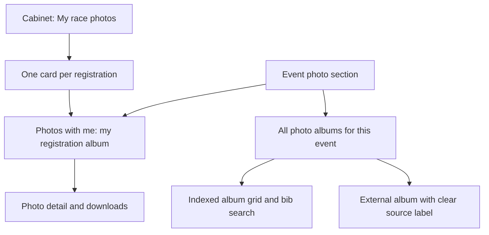

# User journeys: event photos and the personal cabinet (proposed)

**Status**: Specification only. Working English labels below describe meaning; implementation
must supply ru/kk/en copy and check the longest labels against the existing interface rules.

## Entry points and scope

| Surface / action | Destination | What it contains |
| --- | --- | --- |
| Event: **Photos with me** | My registration album for this event; a choice when I have several | Matches and candidates for that registration's confirmed bib(s) |
| Event: **All photo albums** | This event's album cards | Indexed albums, existing curated albums and ordinary external photo-album links, clearly distinguished |
| Cabinet: **My race photos** | One card per registration I can see, newest event first | Registrations I filed, ones where I am the confirmed athlete, and (with #315) my trainees' |
| A registration album card | The same registration grid reached from the event page | That registration's matches across photographers, with an optional source-album filter |
| A photo card | Photo detail / viewer | Photo, event, photographer/source album, original download and back to the same filtered selection |

The event's two actions are sibling navigation links with explicit scope, not two identical
buttons opening different things. Keep the primary personal action and the secondary album action
beside the event's photo section; do not duplicate them in unrelated page controls. The cabinet
needs one cross-event personal entry point, rather than an extra copy of all public galleries.
A registration card may link directly to that event's personal grid using the same action.

## Event page and all-album destination

Show a separate photo section and label its two destinations clearly. "All photo albums" means
all visible photo sources linked to this event, not all gallery albums on the site. Existing
curated photo albums keep their permissions and public pages.

Indexed album cards show cover, localized name, photographer/credit, indexed/processed counts and
indexing status; opening one stays on the site and allows number search. A plain external album
card says it is external and has no site number search; it opens the provider link. Do not invent
its photo count or silently fetch every external image just to draw cards. A missing safe cover
has a neutral placeholder, not an unrelated rider's image.

Existing additional materials continue to hold video, clips, documents and unconverted links.
After an authorized manager classifies an existing photo link, represent that source in the album
section without duplicating its stored URL or showing the same resource twice on the event page.
Retain original source/history and an explicit fallback; classification never erases other
materials. A manager can classify a plain photo link before indexing; it stays explicitly external
and unsearchable until a working index has been imported.

## Personal cabinet overview

Use the current gallery's album-card pattern: cover, localized event name, event date, the
entrant's name and bib, and the count of matching photos. One card per registration: an account
with three registrations at one race sees three cards. Several source albums at one race stay one
card. Event date descending, then stable registration ID, provides deterministic paging. Do not
create duplicate stored albums/photos to implement this view.

The cover is one of my accepted matching photos, not the source album's generic cover. Counts are
my visible matches, never all images in that album. Cards link to the same event-scoped grid as the
event action. Within that grid, source-album/photographer filters keep the original organization.
An all-events bulk action spans my eligible photos; per-event actions stay inside that event.

Do not omit a known owned registration merely because indexing or bib assignment is pending.
Show its explicit state with a neutral cover; distinguish it from events with confirmed matches.
A card for a registration filed for someone else is titled with that entrant's name, never as
the account's own photos; relay names alone link nobody.
Do not build or publish a browsable personal album for an arbitrary account ID.

## Registration grid

Reuse the gallery's thumbnail/detail and pagination patterns; add accessible selection controls for
this feature (the current gallery does not have bulk selection). The heading names the event, the
entrant and the bib; show found count and indexing completeness. A multi-stage team line may own
several bibs; results deduplicate by photo ID. Photos matched through a relay team's shared bib
carry a "team photo" label, because the bib does not say which member is in the frame. Include
photographer/source on each photo or its detail, and preserve credit in download results.

Offer individual download, select/deselect visible photos, download selected and download all
matching photos. Selection is explicit across pagination: show its count and distinguish the
current page from the whole result set. Changing scope/filters explains which selection is kept
or cleared; it never silently downloads photos outside the stated selection. Archive creation
uses the bounded job contract; no ZIP creation in a page request.

Navigation between overview, event grid and detail preserves filters/page/selection for the visit;
an explicit incoming link's event/scope wins over saved choices. Direct personal URLs always resolve
against the current signed-in athlete, never the original link sender. Do not expose a cached
personal response to another account; personal pages are excluded from public indexing/sitemaps.

## States, guest behaviour and truthful feedback

| Situation | Visible result / next action |
| --- | --- |
| Guest opens Photos with me | Explain sign-in, retain event destination; All photo albums remains available if public |
| No confirmed athlete or bib association | Say why personal matching is unavailable; offer event albums / number search, do not require retyping a known bib |
| Entry filed by someone else for me | Offer to accept the submitter's claim link; until then the entry is not "mine" |
| Relay member slot not claimed | The team's album stays with the account that filed it and event search; tell the member how to claim their slot |
| No indexed album yet | Say photos are not indexed; show existing album links rather than an unexplained empty grid |
| Inventory or recognition incomplete | Show discovered/processed counts and partial matches; never claim every photo was checked |
| Fully processed, no accepted matches | Say no matches were found for the confirmed bibs, not that the person is absent from every photograph |
| Source unavailable | Retain authorized metadata and selection; identify unavailable media and retry option |
| Event/album no longer visible | Apply the same 404 and removal rules to cards, counts, covers, detail and archives |

Loading reserves card dimensions; asynchronous counts/status changes are announced accessibly.
Controls have visible text, keyboard focus and the site's minimum tap area; paired event actions
fit one row at the supported widths with the longest translation. Use existing skin variables;
this design does not authorize changing light/dark styling. No camera or face upload is implied
by "Photos with me": this phase matches issued numbers and explains that beside the action.

## Acceptance additions

Verify event and cabinet entry points converge on identical registration results; three source
albums produce one registration card; counts/covers never include another athlete's unmatched photos.
Check guest return after sign-in, one card per registration (three registrations, three cards),
a child's card titled with the child's name, relay team photos labelled for every claimed member, ordinary
external links without false search capability, back navigation, pagination/selection, provider
outage, account switching and removal before archive delivery. Run UI and API cases with equivalent
permissions in all three locales, on phones/desktop and every skin. These are future behaviour
checks; no templates or routes are implemented in this documentation change.
