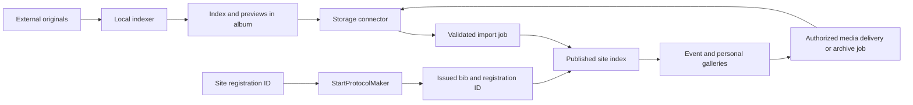

# Implementation Plan: Portable indexed event albums

**Branch**: `349-external-photo-albums` | **Date**: 2026-10-25 | **Spec**: [spec.md](spec.md)
**Input**: Feature specification in `specs/349-external-photo-albums/spec.md`
**Status**: Proposed architecture for maintainer review; no implementation or tasks generated.

## Summary

Keep originals in external albums. A local CPU indexer publishes a portable manifest and previews;
connectors read it into a durable site index. Gallery/search services consume that index and a
provider-neutral asset interface. StartProtocolMaker returns issued bibs against existing site
registration IDs. Historical albums can launch with bib search before account associations exist.

## Technical Context

**Language/Version**: Site Python 3.13 in CI, Django 6, Wagtail 7; existing desktop Python clients.
Local producer has a separate runtime so an OCR dependency cannot force a site dependency upgrade.

**Primary Dependencies**: Existing Django ORM, Django Ninja API, existing gallery actions/permissions.
Use provider HTTP APIs behind adapters; add no dependency merely to render a third-party album.
Select the local OCR engine only after the pilot comparison described in [research](research.md).

**Storage**: External originals and generated previews; PostgreSQL for derived published metadata,
assignments and job state. Bound temporary archive storage; credentials in server secret storage.

**Testing**: pytest/xdist and mocked provider conformance tests; Playwright for setup and galleries;
round-trip tests in StartProtocolMaker, plus compatibility tests for legacy timing clients.

**Target Platform**: Existing Render service behind Cloudflare. Local indexing must have a tested
installation/run guide on the maintainer's pilot computer; advertise other OS support only after
validation. No GPU or paid recognition API is required.

**Project Type**: Existing Django web application/API plus an independent local index producer and
small coordinated desktop-client changes; no new microservice required.

**Performance Goals**: Zero provider calls for metadata search; page-sized database reads.
Validation fixture: 10,000 indexed photos across two albums, 50 results per page. Measure query p95,
CPU indexing throughput, import memory and archive traffic; these are design targets, not measured
production capacity or OCR accuracy claims.

**Constraints**: Existing curated gallery and `/api/v1/` exchanges remain compatible; preserve
original bytes, known form values and last good indexes. No recognition or archive assembly in a
page request. Start with a resumable management-command worker over DB jobs; use the deployment's
scheduler for bounded batches, without introducing a queue service before it is needed.

**Scale/Scope**: Pilot 719 first on Dropbox; pilot 533 when the Drive slice is enabled. Historical
identity recovery and the future SPM round trip can progress independently. Face search and
server/cloud producers remain later reviewed slices, not part of the first number-only pilot.

## Constitution Check

Gates apply before research and again after design, against constitution 1.6.0.

| Principles | Design evidence | Verdict |
| --- | --- | --- |
| I, II, V | Verified source paths in research; draft, atomic docs, review before code, no merge | Pass |
| III | Behaviour validation mapped in quickstart; implementation must ship tests and green CI | Pass for design |
| IV, XII | Localized titles/help/API fields; mobile/keyboard setup and error checks | Pass |
| VI | Registry and capabilities; providers confined to adapters | Pass |
| VII, XI | API contract; optional trailing start-line field that existing readers ignore (A), or acknowledged structured fields (B) | Pass |
| VIII, IX | Manifest and SPM assignments are sources; DB is derived, atomic and recoverable | Pass |
| X | Scoped roots, no tokens in indexes, visibility checks, bounded untrusted inputs | Pass |
| XIII | Preserve registration IDs; reuse known event/profile/connection facts | Pass |
| XIV | Adjacent setup contract with capabilities, sample and local-index guide | Pass |

Post-design recheck: the contracts maintain these gates. No exception requested. Passing the
architecture gate is not evidence that the proposed feature already works or is ready to deploy.

## Project Structure

### Documentation (this feature)

- `spec.md`, `plan.md`, `research.md`, `data-model.md`, `quickstart.md`
- `contracts/connector.md`, `contracts/photo-index.md`, `contracts/start-list-bindings.md`
- `contracts/api-and-setup.md`, `contracts/user-journeys.md`, `contracts/uploads.md`,
  `contracts/recognition-roadmap.md`
- `examples/photo-index.v1.json`, `checklists/requirements.md`, `requirements-coverage.md`, `review.md`
- `tasks.md` is deferred until maintainer review; the review log records the document review cycles.

### Source Code (repository root)

Existing seams to extend during implementation, not files created by this PR:

- `gallery/`: shared search/import/asset actions; a `connectors/` module holds provider adapters.
- `api/endpoints/gallery.py`: organizer and participant operations through shared actions.
- `api/endpoints/start_list.py`, `protocols/models.py`: read registration tokens from uploaded lines
  (variant A) or optional structured bindings (variant B) into issued-bib assignments.
- `registrations/`: issued-bib read model with registration/event provenance, not list-position bibs.
- `tests/`, `tests/e2e/`: permissions, import, compatibility and visible setup contracts.

Sibling repositories requiring later coordinated changes:
`offline_referee/StartProtocolMakerPython` preserves registration references in its lines (its own
spec covers this); `offline_referee/FinishProtocolGeneratorPython` already ignores a trailing field
and may later forward it. The first photo release does not depend on new structured finish
documents or chronometer records.

**Structure Decision**: Reuse gallery domain/actions, but distinguish curated local albums from
external event albums and their different edit rights. Read adapters never decide who owns an
athlete, an event or a photo. An independent producer writes the published format; it does not
require a server token and cannot grant site permissions through its manifest.

## Architecture and flows

The arrows for indexing and import are background work. Gallery metadata queries read only the DB.
Media delivery can require provider I/O and has its own availability/error state.

Event pages gain a separate indexed-photo-album section. Existing additional materials remain
for video, clips, documents and unclassified links. A manager confirms each photo-link
classification, retaining its source/history; searchable indexed status requires a working import.

### User-facing views

The [journey contract](contracts/user-journeys.md) defines two event actions (personal photos and
all albums) and one cabinet entry point into personal event cards. These are projections over the
same photo index, not stored duplicate albums. Personal grids and source-album grids share the
existing gallery card/detail patterns while keeping their scopes, permissions and empty states
explicit. Normal external links remain distinguishable from indexed/searchable albums.

## Delivery slices for later task generation

1. **Historical pilot**: read-only Dropbox connector, local index producer, visible setup help,
   atomic import, event bib search and individual downloads. Several albums per event work here.
2. **Historical identity backfill**: reviewed number-source import and confirmed account links;
   personalized event/cross-event queries use the same search index. No new race registrations.
3. **Future race identity**: preserve references in StartProtocolMaker and derive assignments from
   uploaded start lists; test backups/restart and mixed old/new clients before adoption.
4. **Portability and downloads**: Google Drive reader, public HTTPS conformance adapter and bounded
   archive jobs. Enable each provider only after its access flow is proven on real test albums.

The [site upload slice](contracts/uploads.md) follows the read-only pilot: organizer UI/API,
writable-adapter transfer/resume, job progress and a truthful hand-off to local or enabled
background indexing. It is a retained product requirement, not something an adapter capability
flag alone implements. Test/upload credentials and byte limits before advertising it as ready.

These are reviewable slices, not permission to implement before spec/plan review. Every slice ships
its applicable API, tests, translations and truthful setup help together. Yandex Disk is an extension
candidate. The [recognition roadmap](contracts/recognition-roadmap.md) retains face/selfie search,
bounded site-side recognition and external/cloud producers with acceptance and open gates. Those
are further slices; no choice or implementation is implied by documenting them.

The [coverage matrix](requirements-coverage.md) maps the complete discussion to normative
requirements, scenarios and retained later-stage decisions. It separates documented scope from
implemented or validated capabilities.

## Pilot and implementation gates

The maintainer selected events 533 (Drive) and 719 (Dropbox). Their existing album links are in
additional materials; inspect and obtain authorized access during the later pilot, not this docs
change. Retained start lists/results still need an inventory. Select a labelled sample before
choosing OCR dependencies; compare CPU engines and record accuracy/time rather than assuming
bib OCR is solved. Manager-reviewed annotations and
manually prepared indexes are valid reference fixtures for evaluating the importer.

Google Drive needs a proven authorization route before its implementation slice: `drive.file` must
not be advertised as automatic whole-folder access. If the viable scope requires OAuth verification,
show that operational requirement; do not substitute unapproved broad personal-disk access.

Local indexing help must reference an actual tested tool/version/download before the UI calls it
available. The schema and instructions can be reviewed now; this PR does not pretend that tool exists.

## Complexity Tracking

No constitutional violations. Durable jobs, a derived search index and adapter boundaries address
explicit requirements; do not introduce a generic storage platform, person registry or task queue
service for this pilot.
